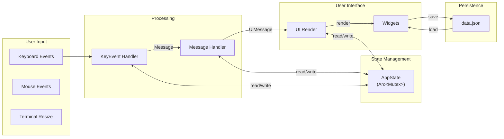
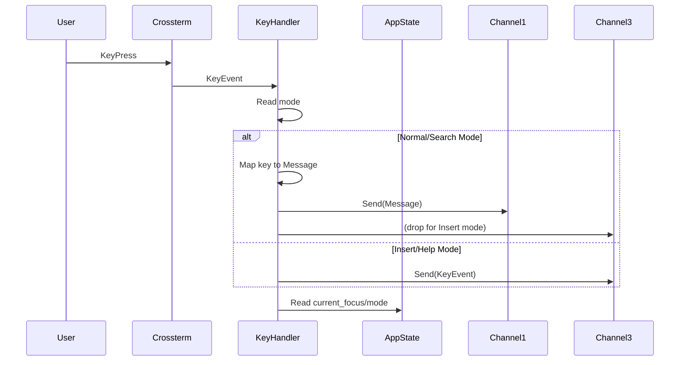
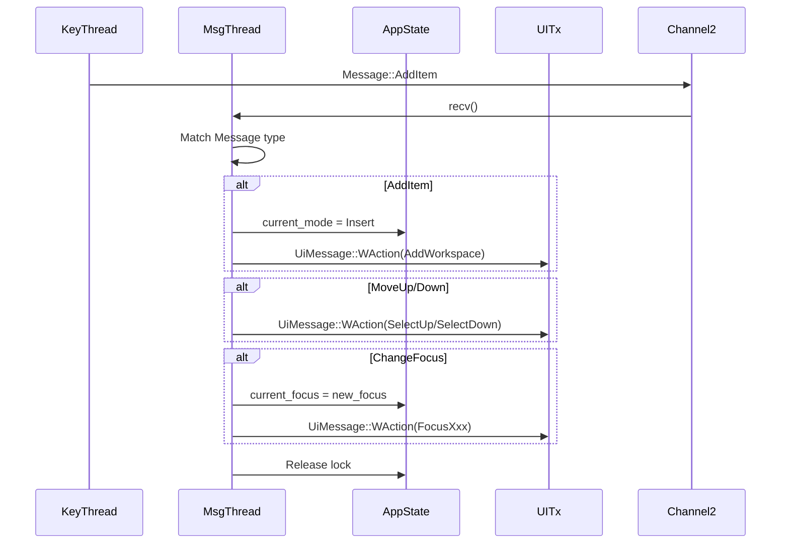
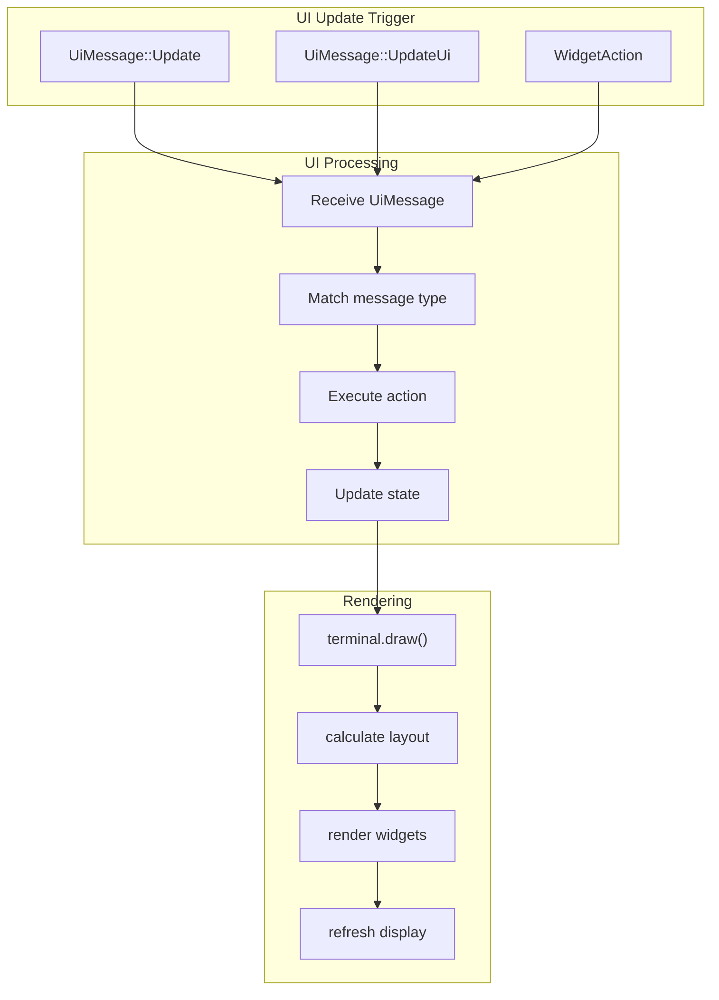
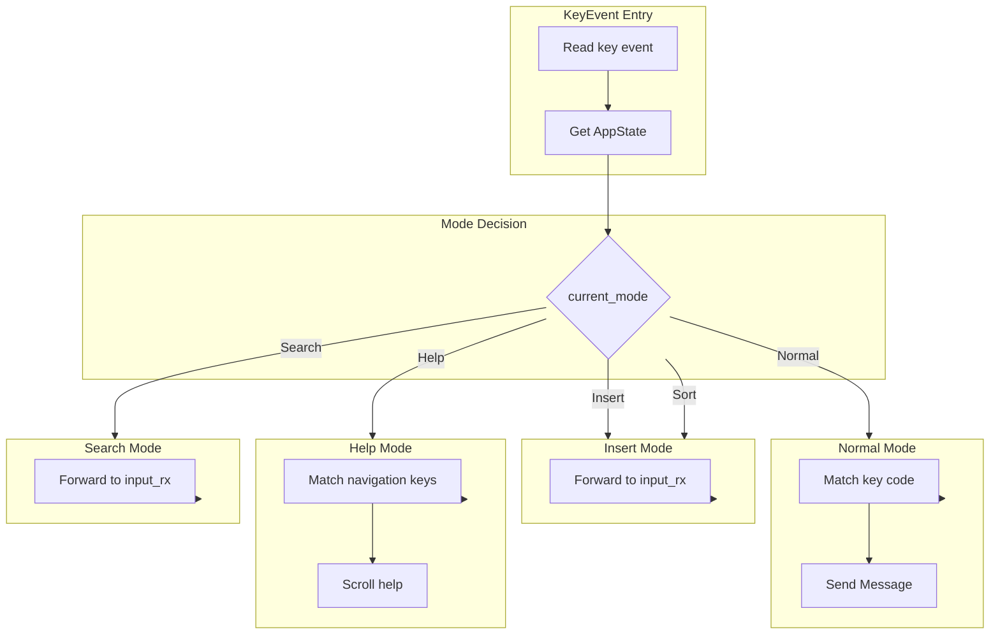
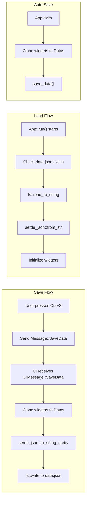
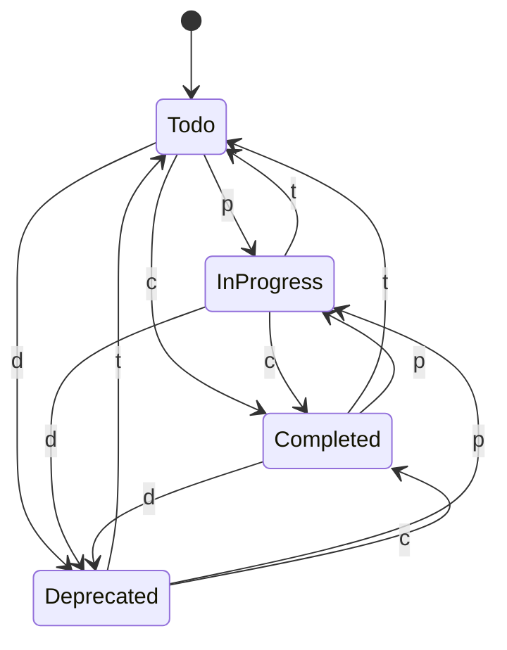
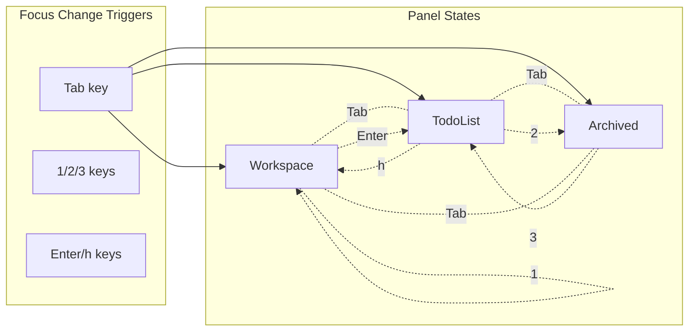
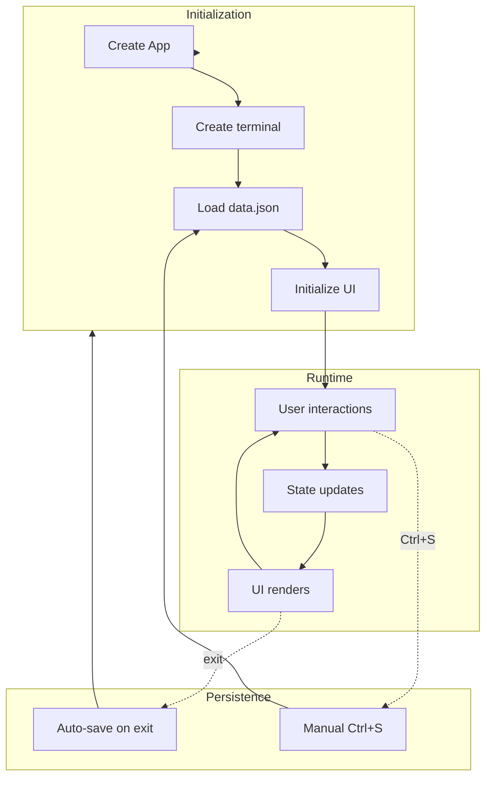

# Data Flow

## 1. Overall Data Flow

## 2. Key Event Flow

## 3. Message Flow

## 4. UI Update Flow

## 5. Control Flow by Mode

## 6. Persistence Flow

## 7. Task State Transitions

## 8. Focus Panel Transitions

## 9. Data Lifecycle

