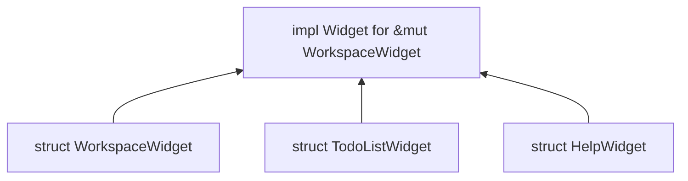
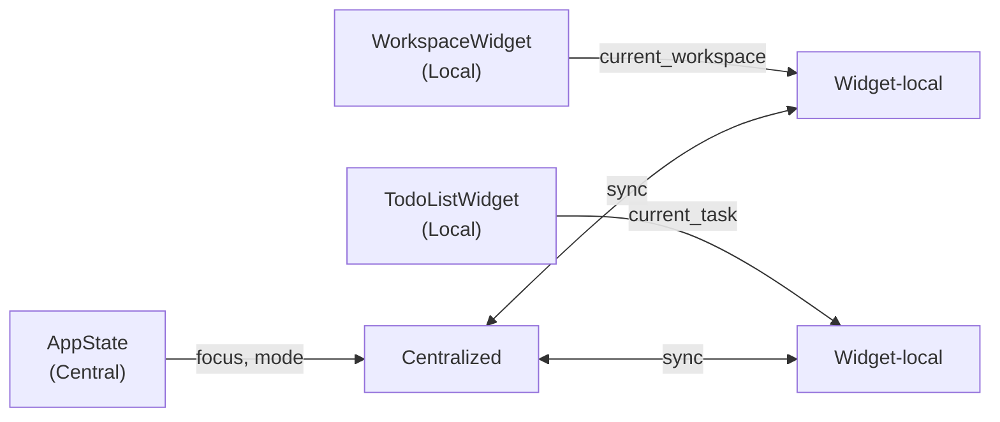
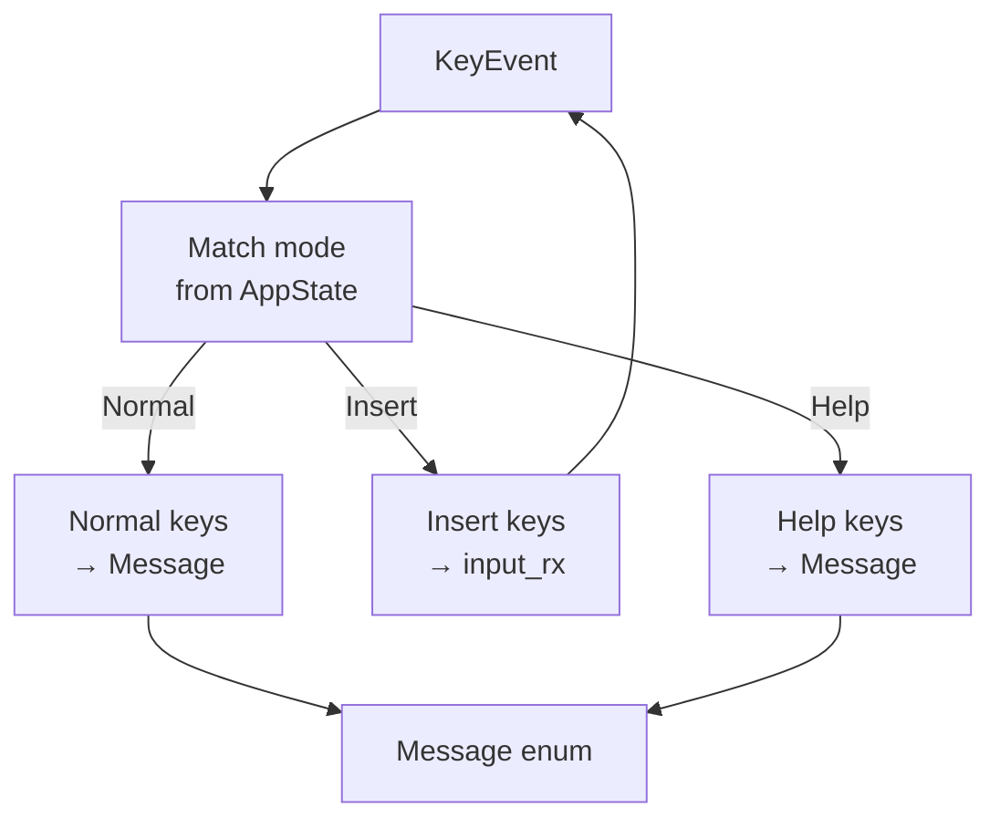
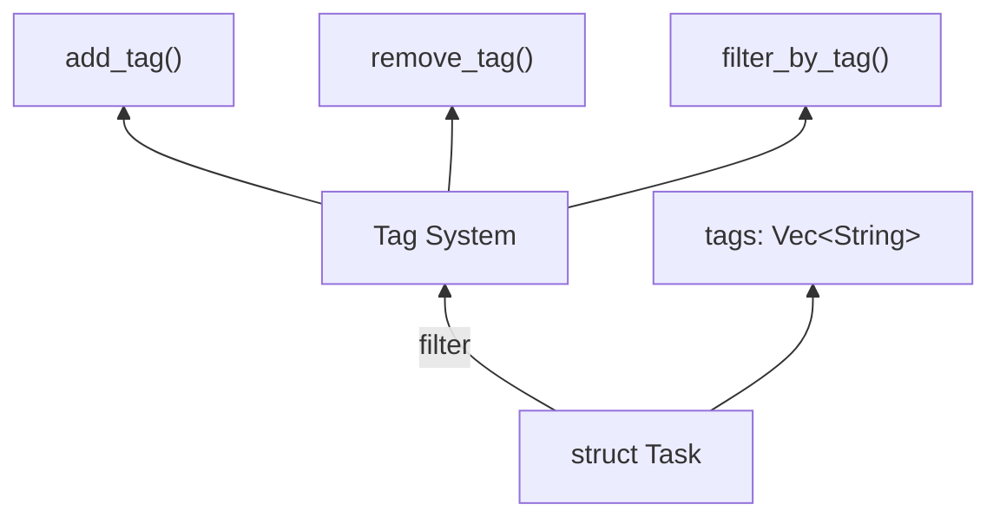

# Architecture Decision Records (ADRs)

## ADR-001: Multi-Threaded Architecture with Message Passing

### Status
Accepted

### Context
The application requires:
- Non-blocking UI rendering
- Keyboard input responsiveness
- Asynchronous message handling
- State sharing between threads

### Decision
Use 3-thread architecture with message passing:

```
KeyEvent Thread ──Message──> Message Handler Thread ──UiMessage──> UI Thread
                              │
                              └──(shared)──> AppState (Arc<Mutex>)
```

### Alternatives Considered

| Alternative | Pros | Cons |
|-------------|------|------|
| **Single-thread async** | Simpler, less memory | Blocking input handling |
| **tokio main loop** | Native async | More complex error handling |
| **rayon parallelism** | CPU parallelism | No UI thread support |

### Consequences

- **Positive**: Responsive UI, clear separation of concerns
- **Negative**: Added complexity, mutex contention potential
- **Trade-off**: Responsiveness over simplicity

### Implementation

```rust
// Thread creation in App::run()
let key_handle = std::thread::spawn(|| {
    let rt = tokio::runtime::Builder::new_current_thread()
        .build()
        .unwrap();
    rt.block_on(handle_keyevt(tx, input_tx, apps_in_keyhand));
});

// Shared state
let appstate: Arc<Mutex<AppState>> = Arc::new(Mutex::new(AppState::new()));
```

---

## ADR-002: ratatui for UI Framework

### Status
Accepted

### Context
Need a TUI framework for Rust that:
- Supports complex layouts
- Handles terminal rendering
- Integrates with crossterm
- Is actively maintained

### Decision
Use `ratatui` 0.29.0 as the UI framework.

### Alternatives Considered

| Alternative | Pros | Cons |
|-------------|------|------|
| **tui** | Predecessor, mature | Deprecated |
| **cursive** | Full-featured | Different paradigm |
| **bubbletea** | Elm architecture | Not idiomatic Rust |

### Consequences

- **Positive**: Active maintenance, serde support, modular widgets
- **Negative**: API changes between versions
- **Trade-off**: Active maintenance over API stability

---

## ADR-003: JSON for Data Persistence

### Status
Accepted

### Context
Need simple data storage that:
- Is human-readable
- Requires no setup
- Supports nested structures
- Is easily backup-able

### Decision
Use JSON file storage at `~/.todo/data.json`.

### Alternatives Considered

| Alternative | Pros | Cons |
|-------------|------|------|
| **SQLite** | Query support, ACID | Setup required, binary format |
| **TOML** | Human-readable | Less ecosystem support |
| **MessagePack** | Compact | Not human-readable |

### Consequences

- **Positive**: No setup, human-readable, easy backup
- **Negative**: No query support, potential large files
- **Trade-off**: Simplicity over features

### Location
```rust
let path = std::env::home_dir()
    .unwrap()
    .join(".todo/data.json");
```

---

## ADR-004: Widget-Based UI Components

### Status
Accepted

### Context
Need to render multiple independent UI sections:
- Workspace list
- Task list
- Help overlay
- Status bar
- Calendar picker

### Decision
Use ratatui Widget trait for each component.



### Consequences

- **Positive**: Reusable, testable, clear boundaries
- **Negative**: Requires state management outside widget
- **Trade-off**: Separation over simplicity

---

## ADR-005: State Management Strategy

### Status
Accepted

### Context
Need to manage:
- Current focus panel
- Current input mode
- Selection state
- Widget data

### Decision
Centralized state with `AppState` + widget-local state.



### Consequences

- **Positive**: Clear ownership, easy debugging
- **Negative**: Synchronization complexity
- **Trade-off**: Clarity over coupling

---

## ADR-006: Keyboard Input Architecture

### Status
Accepted

### Context
Need to handle:
- Mode-specific key handling
- Text input
- Navigation keys
- Action shortcuts

### Decision
Key → Mode → Message dispatch pattern.



### Consequences

- **Positive**: Clear mode separation, extensible
- **Negative**: Duplicated key mappings
- **Trade-off**: Extensibility over DRY

---

## ADR-007: Sort Mode Architecture

### Status
Proposed

### Context
Need to sort tasks by:
- Due date (ascending/descending)
- Urgency (ascending/descending)

### Decision
Implement `Sort` mode that:
1. Displays sort options in keymap
2. Receives sort selection
3. Sorts in-memory
4. Returns to Normal mode

### Proposed Implementation

```rust
pub enum SortOption {
    DueDateAsc,
    DueDateDesc,
    UrgencyAsc,
    UrgencyDesc,
}

fn sort_tasks(tasks: &mut Vec<Task>, option: SortOption) {
    match option {
        DueDateAsc => tasks.sort_by(|a, b| a.due_date.cmp(&b.due_date)),
        // ...
    }
}
```

### Alternatives Considered

| Alternative | Pros | Cons |
|-------------|------|------|
| **Persistent sort** | Remembers preference | Complex state |
| **Multiple sort keys** | Flexible | UI complexity |

### Consequences

- **Positive**: User control, simple implementation
- **Negative**: In-memory only
- **Trade-off**: Simplicity over persistence

---

## ADR-008: Tag System Architecture

### Status
Proposed

### Context
Need to categorize tasks with:
- Multiple tags per task
- Filter by tag
- Display tags in list

### Decision
Add `tags: Vec<String>` to `Task` struct.



### Proposed Data Structure

```rust
impl Task {
    pub fn add_tag(&mut self, tag: String) {
        if !self.tags.contains(&tag) {
            self.tags.push(tag);
        }
    }
    
    pub fn remove_tag(&mut self, tag: &str) {
        self.tags.retain(|t| t != tag);
    }
    
    pub fn has_tag(&self, tag: &str) -> bool {
        self.tags.iter().any(|t| t == tag)
    }
}
```

### Consequences

- **Positive**: Flexible categorization
- **Negative**: Additional complexity in UI
- **Trade-off**: Functionality over simplicity

---

## ADR-009: Module Organization

### Status
Accepted

### Context
Need to organize code that:
- Has clear separation
- Is navigable
- Supports future growth

### Decision
Current structure with target refactoring:

**Current:**
```
src/app/
├── app.rs        # 619 lines (TO DO: split)
├── appstate.rs   # 221 lines
├── data.rs      # 148 lines
└── ui/
    ├── ui.rs   # 1500+ lines (TO DO: split)
    └── *.rs   # Widgets
```

**Target:**
```
src/
├── main.rs
├── app.rs
├── models/      # Data structures
├── actions.rs   # Action enum
├── services/   # Business logic
│   └── persistence.rs
└── ui/
    └── widgets/ # Component widgets
```

### Consequences

- **Positive**: Clear boundaries
- **Negative**: Migration effort
- **Trade-off**: Long-term maintainability over short-term speed

---

## Summary: All ADRs

| ADR | Title | Status |
|-----|-------|--------|
| ADR-001 | Multi-Threaded Architecture | Accepted |
| ADR-002 | ratatui for UI Framework | Accepted |
| ADR-003 | JSON for Data Persistence | Accepted |
| ADR-004 | Widget-Based UI Components | Accepted |
| ADR-005 | State Management Strategy | Accepted |
| ADR-006 | Keyboard Input Architecture | Accepted |
| ADR-007 | Sort Mode Architecture | Proposed |
| ADR-008 | Tag System Architecture | Proposed |
| ADR-009 | Module Organization | Accepted |