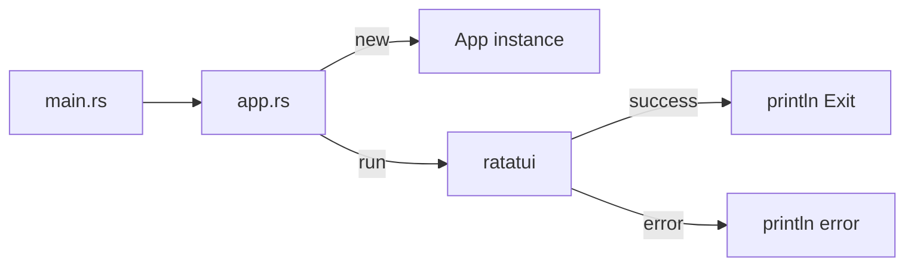
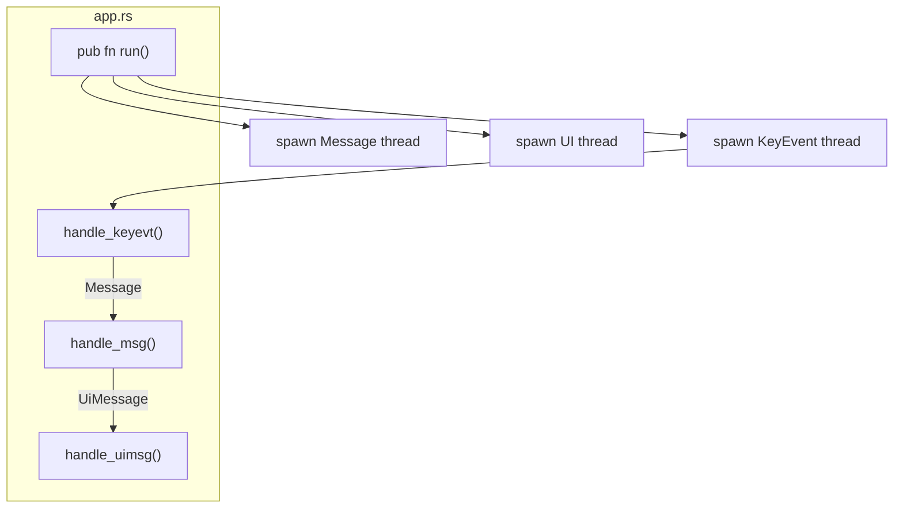
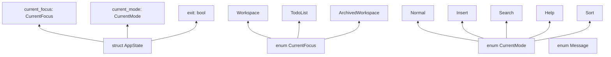
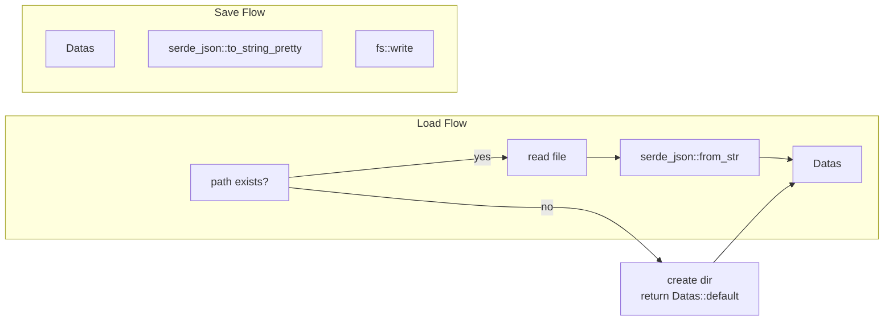
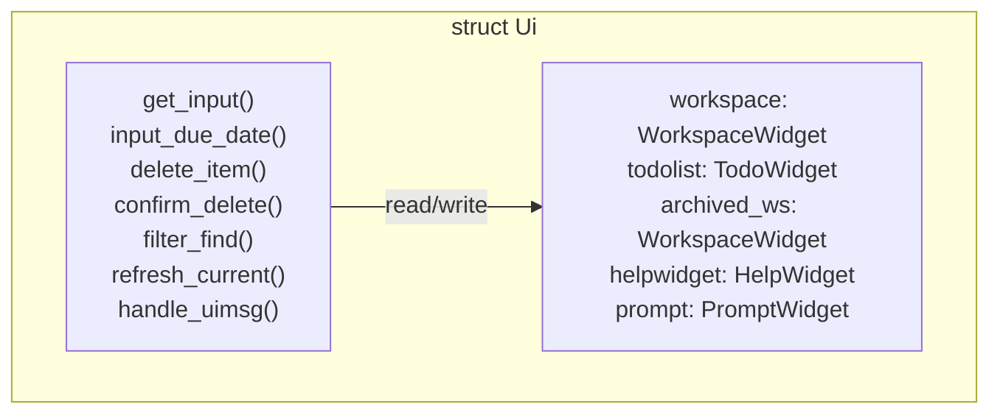
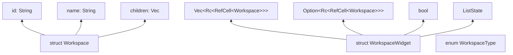
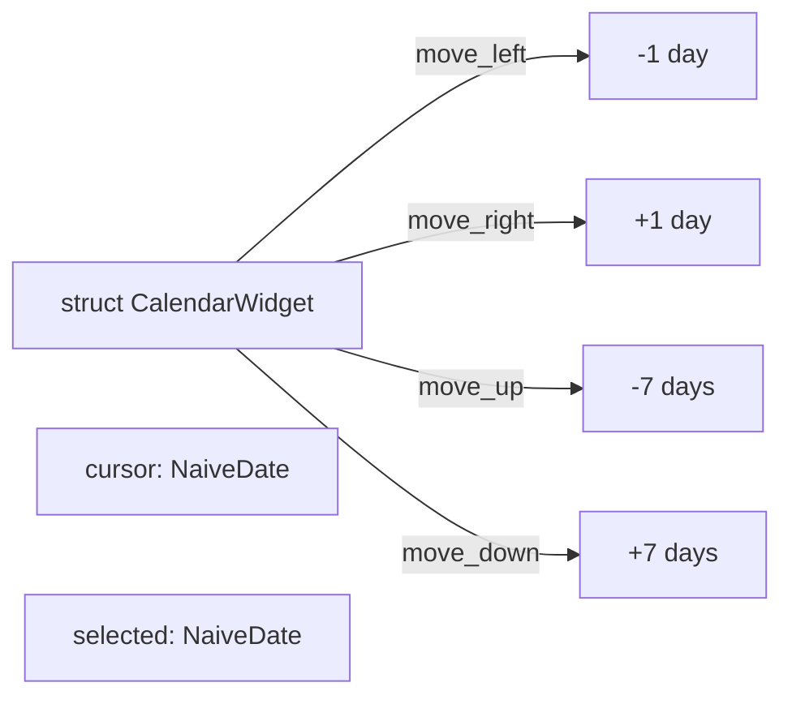
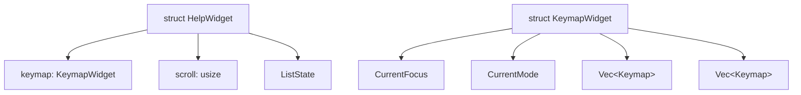

# Module Design

## 1. Module Structure

```
src/
├── main.rs              # Entry point (58 lines)
├── app.rs              # Main coordinator (619 lines)
│   ├── handle_keyevt()  # Key → Message
│   ├── handle_msg()    # Message → UiMessage
│   └── handle_uimsg()  # UiMessage → UI update
│
├── app/
│   ├── appstate.rs     # State management
│   ├── data.rs        # Persistence
│   ├── errors.rs      # Error types
│   └── ui/
│       ├── ui.rs            # UI orchestration
│       ├── workspacewidget.rs  # Workspace list
│       ├── todolistwidget.rs  # Task list
│       ├── calendarwidget.rs   # Date picker
│       ├── helpwidget.rs     # Help overlay
│       ├── keymap.rs        # Key hints
│       └── prompt.rs       # Status bar
```

## 2. Module Responsibilities

### 2.1 main.rs

| Responsibility | API |
|---------------|-----|
| Entry point | `main()` |
| Create App | `App::new()` |
| Run App | `App::run()` |
| Error handling | `Result<(), Errors>` |



### 2.2 app.rs

| Responsibility | Functions |
|---------------|----------|
| Thread creation | `run()` |
| Key handling | `handle_keyevt()` |
| Message handling | `handle_msg()` |
| UI coordination | `handle_uimsg()` |



#### handle_keyevt()

| Aspect | Detail |
|-------|-------|
| Input | `KeyEvent` from `crossterm::event::read()` |
| Output | `Message` to message handler, `KeyEvent` to input handler |
| State | Read `current_focus`, `current_mode` from `AppState` |
| Modes | Normal, Insert, Search, Help, Sort |

```rust
async fn handle_keyevt(
    tx: mpsc::Sender<Message>,
    input_tx: mpsc::Sender<KeyEvent>,
    appstate: Arc<Mutex<AppState>>,
) {
    // Loop: read key → match mode → send message
}
```

#### handle_msg()

| Aspect | Detail |
|-------|-------|
| Input | `Message` from channel |
| Output | `UiMessage` to UI thread |
| State | Write `current_mode`, `current_focus` to `AppState` |
| Actions | Map Message to UiMessage |

```rust
async fn handle_msg(
    rx: mpsc::Receiver<Message>,
    ui_tx: mpsc::Sender<UiMessage>,
    appstate: Arc<Mutex<AppState>>,
) {
    // Loop: recv message → match → send ui message
}
```

#### handle_uimsg()

| Aspect | Detail |
|-------|-------|
| Input | `UiMessage` from channel |
| Output | Terminal render |
| State | Read/Write widget state |
| Actions | Execute widget actions, render |

```rust
async fn handle_uimsg(
    terminal: &mut DefaultTerminal,
    appstate: Arc<Mutex<AppState>>,
) {
    // Loop: recv ui message → execute → render
}
```

### 2.3 appstate.rs

| Responsibility | Types |
|---------------|-------|
| Global state | `AppState` |
| Focus management | `CurrentFocus` |
| Mode management | `CurrentMode` |
| Message types | `Message` |



### 2.4 data.rs

| Responsibility | Functions |
|---------------|----------|
| Data container | `Datas` struct |
| Load data | `load_data(path)` |
| Save data | `save_data(path, datas)` |



### 2.5 ui.rs

| Responsibility | Methods |
|---------------|--------|
| Widget management | `Ui` struct |
| Rendering | `update(f)` |
| Input dialogs | `get_input()`, `input_due_date()` |
| Confirmation | `delete_item()`, `confirm_delete()` |
| Search | `filter_find()` |



### 2.6 workspacewidget.rs

| Responsibility | Types |
|---------------|-------|
| Workspace data | `Workspace` struct |
| Widget rendering | `WorkspaceWidget` struct |
| Workspace type | `WorkspaceType` enum |



### 2.7 todolistwidget.rs

| Responsibility | Types |
|---------------|-------|
| Task data | `Task` struct |
| Task status | `TaskStatus` enum |
| Task list | `TodoList` struct |
| Widget | `TodoWidget` struct |

```mermaid
graph BT
    Task["struct Task"]
    TaskStatus["enum TaskStatus"]
    TodoList["struct TodoList"]
    TodoWidget["struct TodoWidget"]
    
    Task --> title["title: String"]
    Task --> status["status: TaskStatus"]
    Task --> due_date["due_date: Option&ltString&gt"]
    Task --> urgency["urgency: i32"]
    Task --> children["children: Vec&ltRc&ltRefCell&ltTask&gt&gt;&gt;"]
    Task -->|NEW| tags["tags: Vec&ltString&gt"]
    
    TaskStatus --> Todo["Todo"]
    TaskStatus --> InProgress["InProgress"]
    TaskStatus --> Completed["Finished"]
    TaskStatus --> Deprecated["Deprecated"]
    
    TodoList --> tasks["Vec&ltRc&ltRefCell&ltTask&gt&gt;&gt;"]
    TodoList --> current_task["Option&ltRc&ltRefCell&ltTask&gt&gt;&gt;"]
    TodoWidget --> todolists["Vec&ltRc&ltRefCell&ltTodoList&gt&gt;&gt;"]
    TodoWidget --> current_todolist["Option&ltRc&ltRefCell&ltTodoList&gt&gt;&gt;"]
```



### 2.8 calendarwidget.rs

| Responsibility | Features |
|---------------|---------|
| Calendar display | `CalendarWidget` struct |
| Navigation | `move_left()`, `move_right()`, `move_up()`, `move_down()` |
| Selection | `cursor: NaiveDate` |



### 2.9 helpwidget.rs

| Responsibility | Features |
|---------------|---------|
| Help display | `HelpWidget` struct |
| Key hints | `KeymapWidget` struct |
| Scroll | `scroll: usize`, `state: ListState` |



## 3. Public API Summary

### 3.1 Exported Types

| Module | Type | Visibility |
|--------|------|----------|
| `app::` | `App` | `pub` |
| `appstate::` | `AppState`, `Message`, `CurrentFocus`, `CurrentMode` | `pub` |
| `data::` | `Datas` | `pub` |
| `errors::` | `Errors` | `pub` |
| `ui::` | `Ui`, `UiMessage`, `WidgetAction` | `pub` |
| `ui::` | `SearchEvent`, `SelectBF` | `pub` |
| `ui::workspacewidget::` | `Workspace`, `WorkspaceWidget`, `WorkspaceType` | `pub` |
| `ui::todolistwidget::` | `Task`, `TaskStatus`, `TodoList`, `TodoWidget` | `pub` |

### 3.2 Function Signatures

```rust
// main.rs
pub fn main() { ... }

// app.rs
impl App {
    pub fn new() -> Self { ... }
    pub fn run(&self) -> Result<(), Errors> { ... }
}

// data.rs
pub fn save_data(path: &Path, datas: &Datas) -> Result<(), Errors> { ... }
pub fn load_data(path: &Path) -> Result<Datas, Errors> { ... }

// ui.rs
impl Ui {
    pub async fn get_input(...) -> String { ... }
    pub async fn input_due_date(...) -> String { ... }
    pub async fn delete_item(...) -> bool { ... }
    pub async fn confirm_delete(...) -> bool { ... }
    pub async fn filter_find(...) -> String { ... }
    pub async fn handle_uimsg(...) { ... }
    pub fn update(&mut self, f: &mut Frame) { ... }
}
```

## 4. Code Statistics

| File | Lines | Responsibility |
|------|-------|-------------|
| `main.rs` | 58 | Entry point |
| `app.rs` | 619 | Coordination (TO DO: shrink) |
| `appstate.rs` | 221 | State management |
| `data.rs` | 148 | Persistence |
| `errors.rs` | 46 | Error types |
| `ui.rs` | 1500+ | UI orchestration (TO DO: split) |
| `workspacewidget.rs` | ~300 | Workspace widget |
| `todolistwidget.rs` | ~400 | Task widget |
| `calendarwidget.rs` | ~150 | Calendar widget |
| `helpwidget.rs` | ~100 | Help widget |
| `keymap.rs` | 173 | Key hints |
| `prompt.rs` | ~50 | Status bar |

**Total**: ~3700 lines

## 5. Refactoring Targets

| Priority | File | Target | Action |
|---------|------|--------|--------|
| HIGH | `app.rs` | <200 lines | Extract message handling to services |
| HIGH | `ui.rs` | <500 lines | Split into `ui/` module |
| MEDIUM | `workspacewidget.rs` | Extract sort logic | New `services/sort.rs` |
| MEDIUM | `todolistwidget.rs` | Add tags support | Add `tags` field |
| LOW | `keymap.rs` | Simplify | Move to `ui/` |