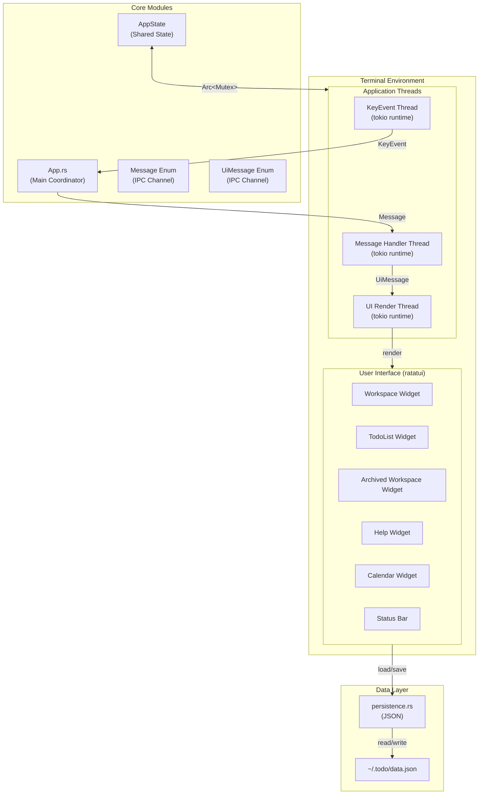
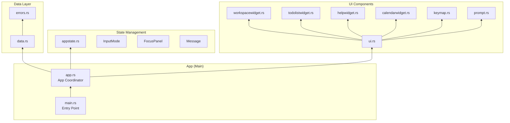
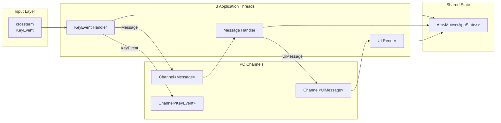
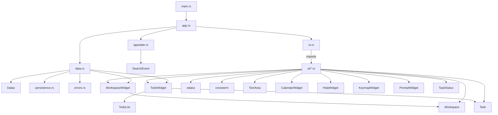
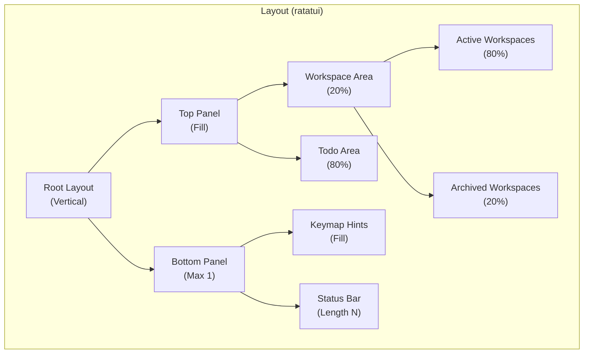
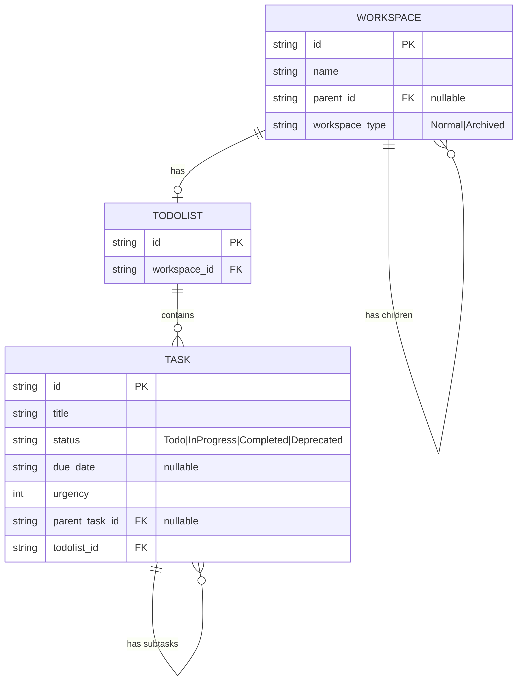
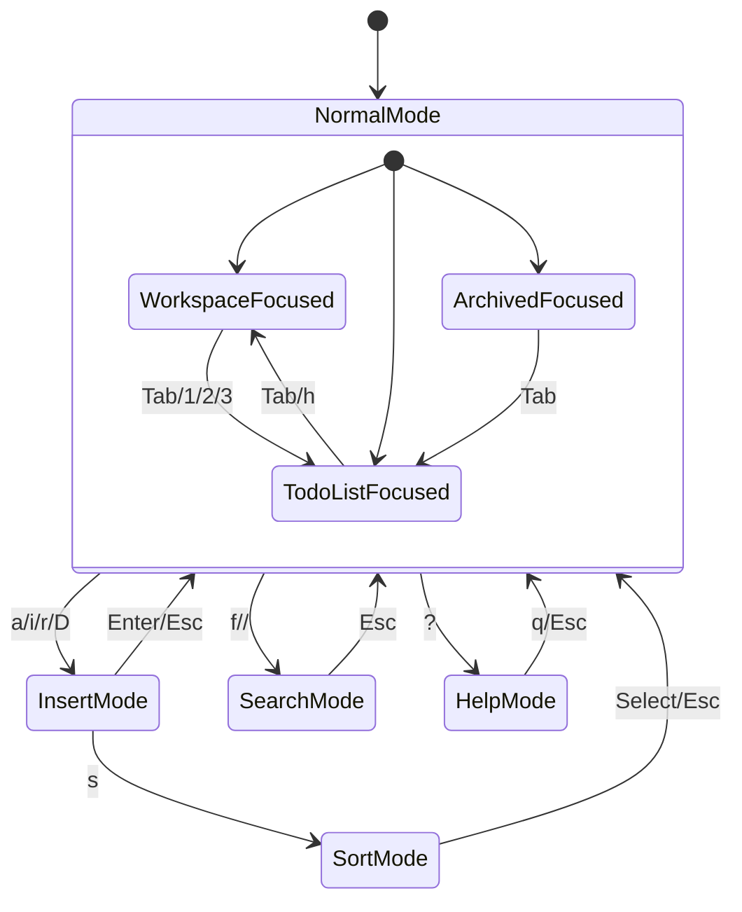

# System Overview

## 1. System Architecture

## 2. Component Hierarchy

## 3. Thread Architecture

## 4. Module Dependency Graph

## 5. UI Layout Structure

## 6. Data Model Architecture

## 7. State Machine

## 8. Component Overview

| Component | Responsibility | Public API |
|-----------|----------------|------------|
| `main.rs` | Entry point | `main()` |
| `app.rs` | Thread coordination | `App::new()`, `App::run()` |
| `appstate.rs` | State management | `AppState`, `Message`, `CurrentMode`, `CurrentFocus` |
| `data.rs` | Persistence | `load_data()`, `save_data()` |
| `ui.rs` | UI orchestration | `Ui::new()`, `Ui::update()` |
| `workspacewidget.rs` | Workspace list | `WorkspaceWidget`, `Workspace` |
| `todolistwidget.rs` | Task list | `TodoWidget`, `TodoList`, `Task` |
| `calendarwidget.rs` | Date picker | `CalendarWidget` |
| `helpwidget.rs` | Help overlay | `HelpWidget` |
| `keymap.rs` | Key hints | `KeymapWidget` |
| `prompt.rs` | Status bar | `PromptWidget` |

## 9. Technology Stack

| Layer | Technology | Version |
|-------|-----------|---------|
| UI Framework | ratatui | 0.29.0 |
| Terminal Input | crossterm | 0.29.0 |
| Async Runtime | tokio | 1.47.1 |
| Serialization | serde_json | 1.0.143 |
| Date/Time | chrono | 0.4.41 |
| Unique IDs | uuid | 1.18.0 |
| Text Input | tui-textarea | 0.7.0 |
| Regex | regex | 1.11.1 |